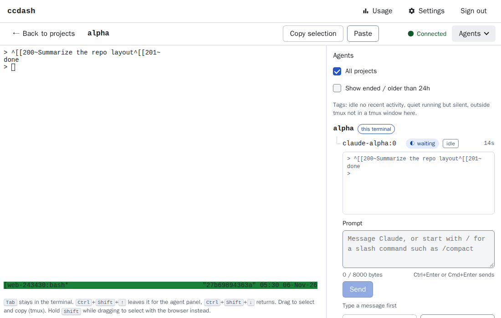

# ccdash

## 1. What it is

ccdash is a web dashboard and tmux in one hardened container. It runs Claude Code as an unprivileged user. You open the dashboard in a browser, start a conversation for a repo, and see what each conversation is doing. You can open a terminal in any of them and answer its permission requests from the dashboard.



Not affiliated with Anthropic.

## 2. Requirements

- Linux on x86_64 or arm64.
- Rootless Docker with the compose plugin.
- Claude Pro or Max.

## 3. Install

```bash
git clone https://github.com/milosanokklis-debug/tmux_cc_dashboard.git
cd tmux_cc_dashboard
sudo ./setup.sh
```

setup.sh does the whole install. It asks no questions. You can run it again safely. It logs to /var/log/ccdash-setup.log.

It does these steps:

- Creates the host user `ccdash` with rootless Docker.
- Pulls the image and starts the stack.
- Creates your dashboard login. The login is your user name and a random 24-character password. The password goes to `~/ccdash-login.txt` (mode 0600).
- Sets the git identity.
- Runs Claude `/login`. This needs a browser approval: open the printed URL and paste the code.
- Sets up the Cloudflare tunnel. This needs a second browser approval (`cloudflared tunnel login`).
- Requires TOTP at the first login. If `CLOUDFLARE_API_TOKEN` is set, setup creates a Cloudflare Access app with email one-time codes instead.
- Runs a live self-test.

Flags:

```bash
sudo ./setup.sh --no-cloudflare
sudo ./setup.sh --hostname <name>
sudo ./setup.sh --no-selftest
sudo ./setup.sh --uninstall
sudo ./setup.sh --uninstall --purge
```

- `--no-cloudflare` skips the tunnel. You reach the dashboard over SSH only.
- `--hostname <name>` sets the public hostname.
- `--no-selftest` skips the live self-test.
- `--uninstall` removes the stack and keeps the volumes.
- `--uninstall --purge` also deletes the volumes.

The dashboard listens on 127.0.0.1:7690 on the host. Reach it through your tunnel hostname, or over SSH:

```bash
ssh -L 7690:127.0.0.1:7690 you@your-server
```

Then open http://localhost:7690 in Chrome or Firefox. Safari may refuse the login cookie over plain http, so do not rely on it for the SSH route.

## 4. Adding a repo

Add a repo in the dashboard with Add project, or from the shell:

```bash
ccd clone owner/repo
ccd clone --trust-hooks owner/repo
ccd pull repo
```

`ccd pull` takes the project name, which is the repo name. Use `--trust-hooks` only for a repo you trust (see below).

For a private repo, or to push, add a fine-grained token in the dashboard first. The shell commands have no token option. Make the token fine-grained and limit it to that one repository. Give it Contents read/write and Metadata read. Never use a classic token. A classic token can reach every repo you can access.

Onboarding refuses:

- A repo name that is not `owner/repo`.
- A folder in the workspace that already holds a different repo.
- A repo whose `.claude/settings.json` or `.claude/settings.local.json` defines hooks or other settings that run code or send credentials (for example `apiKeyHelper`, `env`, `mcpServers`). It also refuses a repo with a `.mcp.json`, settings that are symlinks, and settings it cannot parse. You can trust the repo with `--trust-hooks`, or with the "I trust this repo's hooks" checkbox in the dashboard. Pulls of a trusted repo do not ask again.
- A pull with uncommitted changes, a different origin, a diverged branch, or a branch that tracks another remote.
- A pull whose new commits would add such settings. It refuses before it changes the checkout.

Other commands:

```bash
ccd identity "Your Name" you@example.com
ccd identity --from-host
ccd ls
ccd attach repo
ccd wake <session-id>
ccd login
ccd passwd
ccd passwd --totp
ccd passwd --no-totp
```

- `ccd identity` sets the git name and email. `--from-host` copies the host's global git name and email.
- `ccd ls` lists the conversations.
- `ccd attach` opens the tmux session of a project.
- `ccd wake` resumes a stopped conversation.
- `ccd login` runs Claude so you can log in.
- `ccd passwd` sets a new dashboard password. All sessions end.
- `ccd passwd --totp` turns TOTP on. It shows recovery codes once. `--no-totp` turns TOTP off.

## 5. What survives what

| Event | Running work | Conversation history |
| --- | --- | --- |
| SSH drop or browser closed | Continues | Kept |
| Host logout | Continues | Kept |
| Idle for hours | Keeps waiting, flagged idle | Kept |
| docker compose restart, crash, host reboot | Stops | Kept; Wake resumes it |
| docker compose down -v | Stops | Deleted with the volumes |

Idle conversations are flagged, never killed.

## 6. Security model

Claude and tmux run as the user `ccd`. The dashboard runs as the user `web`. The two users are separate, so `ccd` cannot read the dashboard's files.

The container:

- Has a read-only root filesystem. Only four volumes and tmpfs mounts are writable.
- Drops all Linux capabilities except six that the init system needs.
- Sets `no-new-privileges`.
- Sets pid, memory and CPU limits.
- Binds the port to 127.0.0.1 only.
- Is optionally run under gVisor (`CCDASH_RUNTIME=runsc`). Setup enables it only when the self-test passes.

The dashboard:

- Uses session login with argon2id password hashes and login rate limits.
- Checks Origin on changes and WebSocket connections, and X-CCDash on every POST.
- Keeps an audit log of logins, approvals and other changes, without prompts or tokens.

Setup also turns on two more controls:

- TOTP, a one-time code from an authenticator app, at login.
- An egress allowlist. The container sits on an internal network with no route out. Only a proxy reaches outside, and only for hosts in `egress/allowlist.txt` and any extra hosts you add. See `compose.egress.yaml` and `host/ccdash-egress-allow`.

What Claude can still do inside the container:

- Anything `ccd` can do. It can read and write `/workspace` and `/home/ccd`, run any program, and spend your Claude quota.
- Reach every host the allowlist permits. That includes GitHub, with the token you gave it. Git tokens are readable by `ccd`, because the git helper runs as `ccd`.
- Work around the managed settings and the permission hooks. These are speed bumps, not a sandbox.
- Send data to any allowed host. The egress limit does not stop data from leaving to those hosts.

## 7. Toolchains

To add tools such as Python or Go, build a local image on top of the published one:

```bash
cp Dockerfile.local.example Dockerfile.local
```

Edit `Dockerfile.local`. Then create `compose.local.yaml` as the comments in the example describe. Set `CCDASH_VERSION` in `.env` to the version you build on. Build and run with the local override:

```bash
docker compose -f compose.yaml -f compose.local.yaml up -d --build
```

The local build keeps the image name from `compose.yaml`, so it replaces the published image on your host.

## 8. Upgrading

To upgrade Claude Code on a local build:

1. Set `CLAUDE_CODE_VERSION` in `.env.example` and in `.env`.
2. Rebuild the image:

   ```bash
   docker compose -f compose.yaml -f compose.build.yaml build
   ```

3. Capture the new hook payloads into `tests/fixtures/<version>/`.
4. Run the replay tests against those fixtures:

   ```bash
   FIXTURES_DIR=tests/fixtures/<version> tests/replay-fixtures.sh
   ```

5. Deploy:

   ```bash
   docker compose -f compose.yaml -f compose.build.yaml up -d
   ```

Add the same `-f` flags you use at install time, such as `-f compose.egress.yaml`.

For a released image, set `CCDASH_VERSION` in `.env` to the new version, then run `docker compose pull` and `docker compose up -d`.

## 9. Backup and restore

The data lives in four volumes: `ccdash-home` (Claude login and conversations), `ccdash-workspace` (repos), `ccdash-web` (dashboard login and TOTP secret) and `ccdash-git` (git tokens). Archives hold secrets, so store them safely.

Stop the stack first. Use the same `-f` flags you use to run it:

```bash
docker compose stop
```

Back up each volume into the current folder:

```bash
docker run --rm -v ccdash-home:/v -v "$PWD":/b debian tar czf /b/ccdash-home.tgz -C /v .
docker run --rm -v ccdash-workspace:/v -v "$PWD":/b debian tar czf /b/ccdash-workspace.tgz -C /v .
docker run --rm -v ccdash-web:/v -v "$PWD":/b debian tar czf /b/ccdash-web.tgz -C /v .
docker run --rm -v ccdash-git:/v -v "$PWD":/b debian tar czf /b/ccdash-git.tgz -C /v .
```

Restore an archive into its volume:

```bash
docker run --rm -v ccdash-home:/v -v "$PWD":/b debian tar xzf /b/ccdash-home.tgz -C /v
```

Repeat the restore line for each volume and archive.

Compose names volumes with the project prefix, which is the folder name by default. For example, the volume may be `tmux_cc_dashboard_ccdash-home`. Check the names with `docker volume ls` and use them in the commands.

The commands run as root in the container, so tar keeps the file owners. Add `--numeric-owner` when you create an archive that you will restore on another host. Restoring overwrites files with the same names in the volume. Start the stack again with `docker compose up -d` after the restore.
